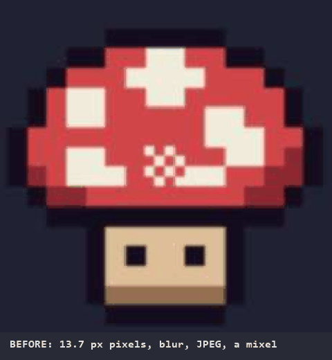
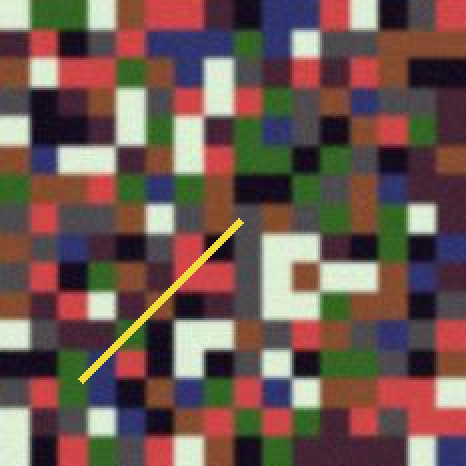
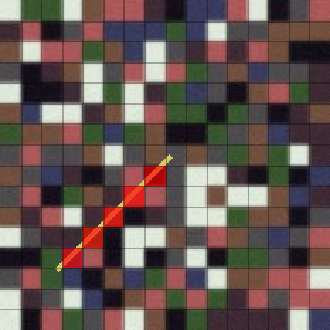
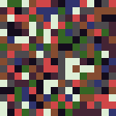

# pixel-snap

**AI "pixel art" is a blurry picture of pixels. This turns it back into a real sprite.**



> RU: ИИ рисует «пиксель-арт», который не держит сетку. pixel-snap находит настоящий пиксель, собирает спрайт заново и показывает, где сетка сломана.

## Try it in one minute

```sh
pip install pillow numpy
curl -O https://raw.githubusercontent.com/klavdiy-core/pixel-snap/main/pixel_snap.py
python pixel_snap.py your_sprite.png --colors 16 --upscale 8
```

It writes `your_sprite.snapped.png` and prints the pixel size it found. Without `--colors` (or `--palette`) every cell keeps its own slightly-off shade. No sprite at hand? `curl -O https://raw.githubusercontent.com/klavdiy-core/pixel-snap/main/examples/messy.png` and run it on that.

## What hurts

Ask an image model for pixel art and you get something that *looks* like pixel art from across the room:

- pixels of different sizes (**mixels**), and a grid that is 7.3 px, not 7;
- soft half-tone edges from upscaling, blur and JPEG;
- 40 shades where the sprite needs 8;
- an image you cannot drop into a game, because a 16×16 sprite came out as a 1024×1024 smear.

Fixing that by hand means guessing the pixel size, resizing, and repainting every cell.

## What it does

1. **Finds the real pixel size and grid offset** from the image itself, fractional sizes included (edge spectrum: cell borders add up in phase at the true period). A smooth upscale (bilinear, bicubic, Lanczos) has no sharp borders, only ramps; there it reads where the ramps bend, at the cell centres.
2. **Rebuilds the sprite at its true resolution**: one colour per cell, read from the cell's centre, so blurred borders don't leak in.
3. **Snaps colours** to `N` colours (k-means) or to your palette (`.hex` or GIMP `.gpl`).
4. **Reports mixed cells**: cells that hold two colours, where the source broke its own grid. `--mixel-map` paints them red so you can fix them by hand.

Transparency is kept: a cell is transparent when most of its centre is.

| messy input (AI-ish, blurred, JPEG, a smear) | mixel map | output, 16×16 (shown ×8) |
|---|---|---|
|  |  |  |

## Use

Python 3.8+, Pillow and numpy; one file.

```sh
python pixel_snap.py sprite.png                          # detect grid, write sprite.snapped.png
python pixel_snap.py sprite.png --colors 16              # also reduce to 16 colours
python pixel_snap.py sprite.png --palette pico8.hex      # snap to a palette
python pixel_snap.py sprite.png -o out.png --upscale 8 --mixel-map mixels.png
python pixel_snap.py sprite.png --scale 7.3 --offset 2 0 # you know the grid better
python pixel_snap.py sprite.png --json                   # machine-readable report
python pixel_snap.py sprite.png --scale-hint 6           # search only near the size you expect
```

Pixel art has square pixels, so the two axes are checked against each other, and every decision is printed as a
`WARNING` line (and `"warning"` in `--json`):

- the axes disagree a little (3-15 %, e.g. 6.0 and 6.4): one square pixel found twice with an error. The stronger
  axis wins for both; `--nonsquare` keeps the two values.
- one axis shows no grid at all (a picture of columns): it takes the other axis's size.
- the axes disagree a lot (5 x 9): a real non-square pixel, kept as found and said, with its aspect (1:1.8).
- no grid at all (a photo, noise): nothing was upscaled; the output is the input, 1:1.
- with `--scale`, more than 20 % of the cells come out mixed: the size or the offset you gave is probably wrong.

The offset is always printed inside one pixel (`--offset 8 16` with `--scale 6` is reported as `[2, 4]`). A missing
or unreadable input is one line on stderr and exit code 2.

Example (the files in `examples/`):

```
$ python pixel_snap.py examples/messy.png -o examples/clean.png --palette examples/palette.hex --upscale 8 --mixel-map mixels.png
pixel size  14.546x14.543  offset [0.17, 0.21]
cells       16x16  mixed 5 (1.95%)
colours     8
wrote       examples/clean.png  map mixels.png
```

As a library:

```python
import numpy as np, pixel_snap
from PIL import Image
res = pixel_snap.snap(np.asarray(Image.open("sprite.png").convert("RGB")), colors=8)
res.grid      # Grid(scale_x=7.31, scale_y=7.31, offset_x=..., offset_y=...)
res.image     # uint8 array, one pixel per cell
res.mixed     # bool array, one flag per cell
```

## Limits

- One grid per image. A scene where sprites were pasted at different scales needs to be cut apart first.
- The grid must be axis-aligned (no rotation) with the same pixel size across the image.
- An image needs at least 4 cells per axis for the grid to be found.
- Dithering survives as dithering; that is the source, not a defect.
- A photo or a painting gets no grid: a grid is used only if the cells' own colours explain at least 75% of the
  image's colour variance. Measured on 949 upscaled sprites with their right grid (nearest, bicubic, bilinear,
  Lanczos, JPEG 60): all at 0.84 or more; photos with the grid the period search invents: 0.73 at most. A sprite whose
  period was found at twice its cell also gets 1:1 and the hint to pass `--scale`, instead of a wrong grid. Before
  0.5.2 every photo tried got a 30-130 px "grid" — found by an external review, fixed in 146c6e1.
- A fully transparent sprite comes back transparent, with no colours (0.5.1; it raised a ValueError with `--colors` —
  found by an external review, fixed in bfcc364).
- Smooth upscales, measured on 144 random sprites (8 sprites × 6 sizes × 3 methods): bicubic 48/48 exact, Lanczos 38/48, bilinear 30/48. The grid is found in all of them; the misses are a few colours read wrong: bilinear only in cells under ~8 px, Lanczos at any size (its ringing tints the cell centre).
- Smooth upscales saved as JPEG (quality 55-75): grid found in 64/64. The bends are read after a light blur that removes JPEG's 8×8 block seams.

## Test

```sh
python -m unittest discover -s tests
```

The tests build a random 16×16 sprite, wreck it (upscale ×7 off-grid, blur, noise, fractional pixel sizes, transparency) and require the exact original back.

## License

MIT
